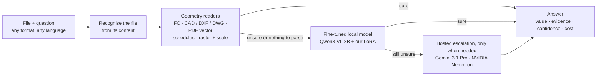

# Blueprint Evidence

**Ask a construction drawing a question in your own words. Get the number, see where it came from, and know how sure it is.**


*"What is the area of the laundry?" asked on one of the sheets Stoa sent as an example of their test, uploaded as a
plain PDF. The answer is 7.03 m² (measured by hand: 7.0 m²) in 2.3 s. The room is traced from the wall lines at the
scale printed on the sheet (1:200) and outlined on the plan, and the cost badge says "cheap": no AI model was needed.
Drawing: Special School Plan Level 00 (SEN-DFE-XX-00-D-X-0201), UK Department for Education, from GOV.UK "A new model
design for a special school". Contains public sector information licensed under the Open Government Licence v3.0.
The sheet is bundled as [samples/dfe_school/plan.pdf](samples/dfe_school/plan.pdf).*

Demo video: [video link]

Team Hannah Family's submission to the Stoa challenge "Make Blueprints Talk" at Junction 2026.

## What it does

- **Answers the questions site engineers ask.** Areas, lengths and counts: "What is the net area of apartment B?",
  "How wide is the corridor?", "How many windows are on the 2nd floor?" In metric and imperial units (m², mm,
  square feet, ft-in), read at the drawing's printed scale.
- **Shows its evidence.** One box per counted object and an outline per measured room on the 2D drawing. In a 3D
  IFC model, the counted elements light up. You can check an answer in seconds.
- **Says how sure it is, honestly.** The confidence is the measured hit rate of the method that produced the
  answer. On the sealed test, answers marked as sure (confidence 0.8 or more) were right 98% of the time. On
  held-out real drawings the few sure answers were less reliable (3 of 7 right), and we say so below.
- **Never just refuses.** When something is missing, such as a scale, you still get a best estimate, the
  assumptions behind it, and what would make it certain.
- **Takes the files people have.** PDF, DXF and DWG, PNG and JPEG (including phone photos of printed sheets), and
  IFC models. It recognises the kind of drawing from the file's content, not from its name.
- **Any language.** Questions and drawings in English, German, French, Finnish, Swedish, Estonian and more.

## Results

All numbers come from our eval tool (`python -m stoa.eval`). Counts must be exact; areas, lengths and volumes must be
within 2%. Commit ids refer to our [workspace repository](https://github.com/Yue-fy/Junction_Hannah_family). Method
and caveats: [docs/RESULTS.md](docs/RESULTS.md).

| Test | Result | Commit |
|---|---|---|
| Stoa's own four example sheets (90 questions in Stoa's kinds: room and type areas, baseboards, slab areas, door counts, piping), local models only, no hosted model | **81.1%** (73/90), evidence on 97% of answers, 8 s per question on a new file | `76f8f94` |
| Same 90 questions: Gemini 3.1 Pro asked directly / Qwen3-VL-8B asked directly | 61%, no evidence / 26% | |
| Same 90 questions, earlier code with the Gemini 3.1 Pro escalation on | 61%, evidence on 98% of answers | `504060a` |
| Sibling sheets of the same drawing sets, held out (never tuned on), local models only | **50.0%** on the first 32 questions (31.3% at `517b67b`); **40.0%** (26/65) on the grown set with line-only school plans and image copies; 41.3% (59/143) on the final set | `1795365` |
| Stoa dataset, sealed test split (2,199 held-out questions, run twice in total) | **87.7%** micro, **79.7%** weighted | `bb94fe4` |
| Real drawings from outside the dataset, development set (168 questions), local models only | **72.0%** | `76f8f94` |
| Real drawings, held-out set (120 questions on other files, never tuned on), local models only | **48.3%** | `68cec39` |
| Real drawings, held-out set, as the API ships (Gemini 3.1 Pro escalation on) | **64.8%** (105 questions) | `fc0927a` |
| For reference: Gemini 3.1 Pro asked directly, first version of the real-drawing set (125 questions) | 43.8%, no evidence | `9e1c725` |

Our main metric is the first four rows: the four sheets Stoa sent as examples of their own test, and sibling sheets
from the same public drawing sets, each uploaded alone under a meaningless name, as Stoa will test. These clean,
large CAD sheets in metric and imperial units are far harder than the dataset. On them our local pipeline, with no
hosted model at all, now answers more questions right than a frontier model asked directly (81.1% against 61%), and it shows where each
answer came from. The first question on a new sheet costs about as much as asking Gemini ($0.010, mostly local GPU
time to read the sheet's text once); each further question on the same sheet costs about $0.0006. The gain carries over to the held-out
sibling sheets (31% to 50% on the first 32 questions), but the grown held-out set, with line-only school plans and image
copies of the sheets, shows how far there is to go (40%, up from 32%), and so do 15 unseen line-only school plans like the DfE
sheet (39%: 50 of 129 room-area, perimeter and label-count questions, up from 13% at `098d71e`). Room areas on
line-only sheets (6 of 10), slab areas by type (3 of 7) and door counts (1 of 2) are still weak, for every system we tried. The real-drawing rows (public drawings from outside the dataset)
add a warning: not every gain on the files we looked at transfers to held-out files (development rows we tuned on all afternoon: 78%;
rows added later: 54%; held-out files: 48%), while the Gemini
escalation does transfer (+15 points on held-out). Weak spots are listed in
[docs/RESULTS.md](docs/RESULTS.md#known-weaknesses).

| Cost tier | What it means | Share of answers: dataset dev / real drawings |
|---|---|---|
| Cheap | No AI model: read from the geometry, the IFC model or the text layer | 67% / 34% |
| In-between | A few calls to a small model (our local 8B) | 33% / 55% |
| Expensive | A large hosted model, or a long chain of model calls | 0% / 11% |

At `0b6f25d`, 1,000 questions cost an estimated $0.03 on the dataset's dev split and $0.28 on the real drawings, with
the drawings' text layers already read (a first question on a new sheet costs more: about $0.01 on Stoa's sheets). On the
sealed test, 56% of answers needed no model call at all. Gemini 3.1 Pro asked directly costs $7.59 per 1,000 questions.

## How it works



1. **Recognise.** The file's content tells us what it is: an IFC model, a CAD sheet, a vector PDF, a schedule, a
   scan or a photo. We also read its storey, printed scale and page. No model call is needed.
2. **Read the geometry.** Most drawings are data. We read IFC models, CAD layers, PDF paths and text, and schedule
   tables with code (IfcOpenShell, ezdxf, PyMuPDF). The answer is exact, and each counted object has its own box.
3. **Ask a small model only when needed.** For scans and photos, our counting LoRA on Qwen3-VL-8B runs on our own GPU.
4. **Escalate only when still unsure.** Gemini 3.1 Pro reads counts and lengths that no reader was sure of, and must
   point at every object it counts. NVIDIA Nemotron checks unsure answers. Both were off for every result above marked "local models only".
5. **Every answer carries its proof.** Each answer comes with evidence (boxes, outlines, measured lines or IFC
   GlobalIds), a calibrated confidence, its assumptions, what is missing, and its cost.

Details: [docs/ARCHITECTURE.md](docs/ARCHITECTURE.md).

## Quick start

You need Python 3.12 and [uv](https://docs.astral.sh/uv/). For the web app you also need Node 20+. The bundled
samples are in `samples/` (see `samples/README.md`). The Stoa dataset is not in this repo, and you don't need it to ask
questions about your own drawings. To run the eval, download it and point `STOA_DATA` at the folder that holds
`questions.jsonl` and `data/`.

```bash
git clone https://github.com/Yue-fy/blueprint-evidence.git && cd blueprint-evidence
uv venv --python 3.12 .venv && uv pip install --python .venv/bin/python -e ".[dev]"
# settings are plain environment variables (names in .env.example); e.g. keep them in .env and load them:
cp .env.example .env && set -a && . ./.env && set +a      # never commit .env
```

Run everything from the repo root: local state (caches, eval splits) goes to `.stoa/` unless `JUNCTION_SHARED` says
otherwise. The CLI reads a relative path from the current folder, or from the dataset root (`STOA_DATA`) when it names
a dataset file.

**(a) API-only mode: no GPU.** The geometry readers run on your CPU. Steps meant for the local model go to a hosted
model instead (Gemini 3 Flash by default) when `GEMINI_API_KEY` is set; `NVIDIA_API_KEY` is optional. With no key at
all, IFC, CAD and vector-PDF questions still work (the bundled samples need no key).

```bash
export STOA_MODE=api        # GEMINI_API_KEY=... for scans, photos and other drawings with nothing to parse
.venv/bin/python -m stoa.cli ask samples/swiss/plan.pdf "How many doors are drawn on this floor plan?" --api
.venv/bin/python -m stoa.cli ask samples/fzk_house/fzk_house.ifc "How many windows are in the building?" --api
.venv/bin/python -m stoa.cli ask samples/dfe_school/plan.pdf "What is the area of the laundry?" --api   # 7.03 m², traced at 1:200
.venv/bin/python -m stoa.cli answer --in samples/questions.jsonl --out answers.jsonl --api   # a few with expected answers
.venv/bin/python -m uvicorn stoa.api:app --port 8100                       # HTTP API: /health, POST /ask, ...
cd web && npm install && npm run dev                                       # web app on http://localhost:5173
```

**(b) Local GPU mode.** vLLM serves Qwen3-VL-8B as an OpenAI-compatible server on port 8001 (`LLM_BASE_URL`). Don't
set `STOA_MODE`. If the server has not answered once since the process started, a model step waits about
`LLM_NEVER_UP_WAIT` seconds (default 15; up to about 30 s with back-off), and further steps then skip the model for
two minutes, so the readers still answer. If a server that was up goes down (a restart), each step waits up to
`LLM_RESTART_WAIT` seconds (default 300) for it to come back. On machines without a GPU, use API-only mode. We run it
on one NVIDIA RTX PRO 6000 (96 GB) with 45% of its memory reserved for vLLM (about 42 GB).

```bash
VLLM_VENV=<venv with vllm> MODEL=<path or HF id of Qwen3-VL-8B-Instruct> serving/start.sh   # LORA=cc-v2=<dir> if you have it
.venv/bin/python -m uvicorn stoa.api:app --port 8100
cd web && npm install && npm run dev
```

Our counting LoRA adapters are not in this repo, because they were trained on CubiCasa5K images (non-commercial).
Without them the base model still runs, but counts on CubiCasa-style plans drop by about 12 points.

Evaluate and test:

```bash
.venv/bin/python -m stoa.eval --list                                   # the solvers
.venv/bin/python -m stoa.eval.splits --write                           # build the splits from $STOA_DATA
.venv/bin/python -m stoa.eval --solver pipeline --split dev            # score the pipeline
.venv/bin/python -m pytest -q                                          # tests needing the dataset or a GPU are skipped
```

The main settings are in `.env.example`. Every environment variable the code reads, with its default, is listed in
[docs/CONFIGURATION.md](docs/CONFIGURATION.md) (generated from the code).

## Repository layout

| Path | What |
|---|---|
| `stoa/` | Python package: answer contract, pipeline and router, solvers (IFC, CAD, PDF, schedules, raster, VLM), evidence, project graph (`kg/`), format normaliser, OCR, agent, eval, cost, HTTP API (`api.py`), CLI (`cli.py`) |
| `stoa/extras/` | Runtime helpers the pipeline imports: room graph of raster plans, raster scale, cross-format link questions over the project graph, CubiCasa5K model wrapper |
| `web/` | Web app (Vite + TypeScript, PDF.js, web-ifc + three.js): answer card, 2D evidence, 3D IFC view, uploads, offline fixtures, small server helpers |
| `serving/` | Start, stop and watchdog scripts for the local vLLM server |
| `deploy/` | Docker image, Google Cloud Run and Verda GPU scripts (no credentials) |
| `tests/` | pytest suite |
| `samples/` | Three small bundled examples: a Swiss Dwellings plan (PDF, DXF, PNG; CC BY 4.0), the FZK-Haus IFC model (KIT) and one of Stoa's example sheets, a UK DfE school plan at 1:200 (Open Government Licence) |
| `docs/` | [RESULTS.md](docs/RESULTS.md), [ARCHITECTURE.md](docs/ARCHITECTURE.md), [DATA_AND_LICENCES.md](docs/DATA_AND_LICENCES.md), [CONTRACT.md](docs/CONTRACT.md) (API, data shapes), [CONFIGURATION.md](docs/CONFIGURATION.md) (every environment variable) |

## Tech challenge notes

- **Google Gemini.** Gemini 3.1 Pro is the hosted escalation for uploads. When no geometry reader is sure of a
  count or a length, Gemini reads the drawing. It must return a box per counted object, or the endpoints it
  measured. Its confidence comes from agreement with our own reading or with a second sample, never from its
  self-report. On the real-drawing development set this hybrid scored 72.8% against 42.1% without Gemini on the same
  code (counts 62 → 97%, lengths 30 → 79%; areas unchanged). The cost is $7.82 per 1,000 questions. Gemini 3.1 Pro
  also plans for the general agent (unseen question kinds), and Gemini 3 Flash stands in for the local model in
  API-only mode.
- **NVIDIA Nemotron.** Nemotron 3.5 Super VL is the visible verifier. It sees the question, our answer, the
  reasoning and a crop of the evidence, and agrees or disagrees. When it disagrees with an answer that has no
  located evidence, the confidence is halved; the value never changes. The web app shows its verdict as a second
  opinion. As a counter it was worse than our LoRA, so it does not count.
- **Verda.** We scored the whole Stoa dataset (127,044 questions on 5,939 drawings) in 17.2 minutes on one Verda
  RTX PRO 6000 GPU with confidential computing, for €0.75 (82.6% of 126,208 scored questions, commit `f551070`).
  On our shared workstation the same run would take hours. The scripts are in `deploy/verda/`.

## Credits and licences

Our code is MIT-licensed ([LICENSE](LICENSE)). The Stoa dataset is not in this repo, and every drawing keeps its own
licence. Some are non-commercial, share-alike or no-derivatives. Our LoRA adapters and the optional CubiCasa5K
model weights are non-commercial and are not in this repo. PyMuPDF (AGPL-3.0) and IfcOpenShell (LGPL-3.0) are
installed as dependencies, not bundled. LibreDWG (GPL-3.0) is called as a separate program for DWG files. Full list
with credits: [docs/DATA_AND_LICENCES.md](docs/DATA_AND_LICENCES.md).

Thanks to Stoa for the challenge and the dataset, and to every author of the drawings and models it contains.

## Team

Yue, Erin, Joanna, Ziying.

Our development history, experiments and per-agent notes live in the team's hackathon workspace repository,
https://github.com/Yue-fy/Junction_Hannah_family. Code comments that cite `experiments/...` scripts refer to that
repository.
