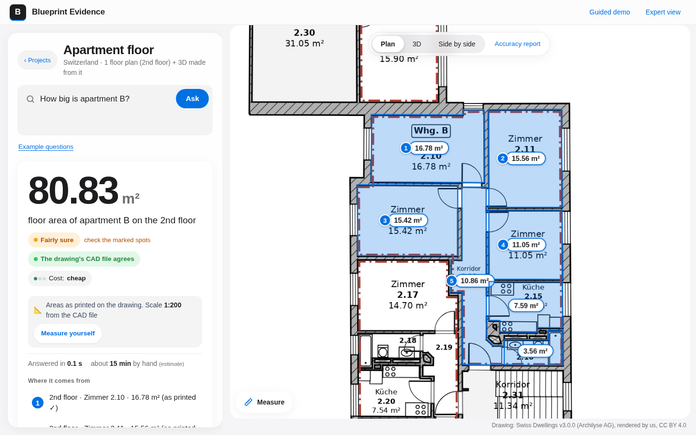
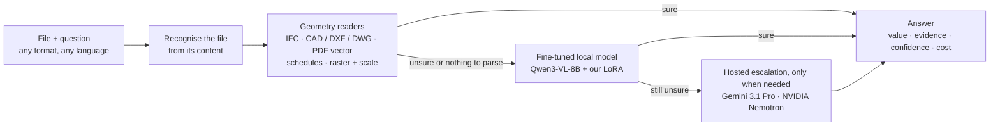

# Blueprint Evidence

**Ask a construction drawing a question in your own words. Get the number, see where it came from, and know how sure it is.**



*"What is the area of the laundry?" asked on one of the sheets Stoa sent as an example of their test, uploaded as a
plain PDF (web app on Saturday night, API at commit `c662016`). The answer is 7.03 m² (measured by hand: 7.0 m²) in
2.6 s (this sheet's text had been read before). The room is traced from the wall lines at the scale printed on the
sheet (1:200) and outlined on the plan; the card states the convention (net internal area, to the inner wall face) and
its assumptions, and offers "Measure yourself". With the Private switch off, as here, the answer also made one
Gemini call (about $0.004), and the cost line says so. This sheet is one of the four we tuned on (see Results).
Drawing: Special School Plan Level 00 (SEN-DFE-XX-00-D-X-0201), UK Department for Education, from GOV.UK "A new model
design for a special school". Contains public sector information licensed under the Open Government Licence v3.0.
The sheet is bundled as [samples/dfe_school/plan.pdf](samples/dfe_school/plan.pdf).*

Demo video (2:28): https://youtu.be/G-aLb5OFr9Y · Launch film (90 s): https://youtu.be/alYQhzlKdLo

Live demo (no password): https://aalto-trx50-ai-top.tailaec1b5.ts.net:10000

Cost: ≈ €0.005 per 1,000 questions (all 127,044 dataset questions for €0.63 on one Verda GPU).

Team Hannah Family's submission to the Stoa challenge "Make Blueprints Talk" at Junction 2026.

## What it does

- **Answers the questions site engineers ask.** Areas, lengths and counts: "What is the net area of apartment B?",
  "How wide is the corridor?", "How many windows are on the 2nd floor?" In metric and imperial units (m², mm,
  square feet, ft-in), read at the drawing's printed scale.
- **Points at its evidence.** When a reader locates what it used, the answer shows it on the 2D drawing: a box per
  object it counted, the outline of a measured room, the measured line. In a 3D IFC model, the counted elements light
  up. An answer whose evidence was not located says so. A location is not a proof: it shows where to look, and a
  human still has to check that it supports the number (in our expert calibration, checking 34 answers on our review
  page took a median of 79 s per answer).
- **Says how sure it is.** The confidence is the measured hit rate of the method that produced the answer, on the
  data that method was measured on. On the dataset's sealed test (`bb94fe4`), answers marked as sure (confidence 0.8
  or more) were right 98% of the time, and on the open questions about Stoa's sheets 189 of 191 (`e4a166b`; from `4b62b93` on a
  confidence map marks more answers as sure; 109 of 112 at `b8146dd`; sheets we tuned on). That does not carry over to new drawings: on held-out real drawings only 3 of
  7 sure answers were right (`0b6f25d`), so on your own drawings treat "sure" as a hint.
- **Exports a takeoff.** Every answer of a visit becomes one CSV row (question, value, unit, how sure, sheet and
  page, method, evidence, where the data went), ready for a spreadsheet.
- **Never just refuses.** When something is missing, such as a scale, you still get a best estimate, the
  assumptions behind it, and what would make it certain.
- **Takes the files people have.** PDF, DXF and DWG, PNG and JPEG (including phone photos of printed sheets), and
  IFC models. It recognises the kind of drawing from the file's content, not from its name.
- **Any language.** Questions and drawings in English, German, French, Finnish, Swedish, Estonian and more.

## Optional features

These run on top of the same answers and evidence, and are **off unless you switch them on**: on the API with
`STOA_FEATURES=<name>,<name>` (or `all`), in the web app with `?features=<name>,<name>` (remembered in your
browser; `?features=` with nothing switches them off again). On the API a feature that fails to load is
skipped; in the web app one that fails switches itself off. The rest of the app keeps working. The live demo during judging has 12 of them on: `privacy`, `region`, `corrections`, `project`, `takeoff`, `orderlist`, `conventions`, `checklist`, `report`, `selfcheck`, `xref`, `revcompare`.

| Feature | What it does | Parts |
|---|---|---|
| **Ask about part of a sheet** (`region`) | Drag a box or a lasso on the drawing; counts, areas and lengths are read inside it only. | API + web |
| **Quantity takeoff** (`takeoff`) | One click lists every room's floor area, skirting length (perimeter minus door openings), doors and windows, with sheet totals. Each row outlines its source on the drawing. Exports to CSV / XLSX. Runs on your server, with no hosted model. | API + web |
| **Self-check** (`selfcheck`) | Finds places where a sheet disagrees with itself: an area table whose total is not the sum of its rows, a dimension chain that does not add up, a dimension number that does not match its drawn line, a scale bar against the printed 1:N, one room number used for two rooms, a printed room area against the room as drawn. Each finding shows both readings and where they are; what could not be read is listed as skipped, never as an error. No model calls. | API + web |
| **Revision compare** (`revcompare`) | Drop a newer issue of a sheet (PDF, scan or photo). It is aligned with the old one (exactly on CAD PDFs, by image registration on scans and photos), and the lines and labels that were added, removed or changed are marked; a changed printed area shows both values ("62 m² → 55 m²"). Suggested follow-up questions, such as door counts or the areas of rooms next to a change, are answered on both versions the normal way. | API + web |
| **Trust map** (`trust_map`) | Colours the sheet by how reliably each region could be read (green, amber, red), so you know where to double-check before you trust a number. | API + web |
| **Learn from corrections** (`corrections`) | When you fix a scale, pick an interpretation, mark a door we missed or give the right value, the project remembers it; later answers on the same project use it and say so. Undo is one click. | API + web |
| **Cross-references** (`xref`) | Callouts and sheet references become clickable, and answers follow them (a door's size leads to the door schedule sheet). | API + web |
| **Projects** (`project`) | Upload several sheets of one building. Sheet roles and levels are recognised, building totals avoid double counting (sections, ceiling plans, duplicates; when a total is not safe you get the per-sheet values and the reason), and a review list keeps every answered quantity with a tick, your corrections and the open questions. | API + web |
| **Privacy controls** (`privacy`) | A Private switch that keeps every step on your server, a line on each answer saying where its data went, what is stored where and for how long, and a button that deletes your uploaded files and the cached readings tied to them (caches it cannot tie to a file are listed, not skipped silently). | API + web |
| **Order list** (`orderlist`) | Turns the quantity takeoff into what you would order: skirting as pieces of a stock length per room (plus waste), doors by size (the printed size tag, else measured from the door swing; a double door is one set of two leaves), floor covering by room type (plus waste). Defaults (10 % waste, 2.4 m lengths, 2.1 m door height) are labelled as defaults and can be changed; doubtful rooms are listed for checking by hand and left out of the totals. Every line outlines its evidence. Exports to CSV / XLSX. No model calls. | API + web |
| **Measurement report** (`report`) | One click on an answer gives a print-ready A4 page: the drawing crop with the answer's outlines and marks, a small map of the whole sheet, the formula, the scale and where it came from, the convention, the assumptions, the method and code version, the date and a 'Checked by' line. It is built from the answer on screen: nothing is asked again and no model is called. | API + web |
| **Check list** (`checklist`) | Ranks every takeoff row and every answer on the sheet by how likely it is to be wrong (from the reader's confidence, how well its evidence supports it, whether two methods agree, the trust map and whether the scale is confirmed; the weights are fitted on our own eval runs), so you check only what needs it: "Check these 6 of 149 first". Each row gives its reasons and zooms to its spot; a tick marks it checked and puts it back into the totals, and rows nobody has checked stay out of the totals. | API + web |
| **Many questions** (`batch`) | Paste a list of questions (or several lines in the main question box), or drop a .txt / .csv / .xlsx / Word / PDF list, even a whole e-mail. Each question is answered on the open drawing (or on the drawing / sheet the list names) the same way as a typed one, in a live table with the answer, how sure we are, the cost, the time and a link to the evidence; exports to CSV / Excel / a report with pictures. Whole-floor answers are checked against the sheet's own room-by-room takeoff, and with an 'expected' column it reports how many answers match, by kind (areas, lengths, counts). | web |
| **Measuring conventions** (`conventions`) | Switches over the quantity takeoff: floor area net (the default), to wall centre lines or gross; skirting with or without wet rooms; door openings deducted or not; doors counted as sets or as leaves. A switch recounts every room and total at once and shows the change against the default; every exported row names its convention. | web |

## Results

All numbers come from our eval tool (`python -m stoa.eval`). Counts must be exact; areas, lengths and volumes must be
within 2%. Each row names its mode and the commit it was measured on (on the `night` branch of our
[workspace repository](https://github.com/Yue-fy/Junction_Hannah_family)). The code in this repository is commit `353b779` of that branch, and every commit named below is in its history. The live demo during judging runs this same code, with the Private switch on by default (private mode). **Private** = local models only, every
hosted model off; **hybrid** = with the Gemini 3.1 Pro escalation and the Nemotron check on. Except in the dataset's
sealed test, every file is uploaded alone under a meaningless name, as Stoa will test. Method and caveats: [docs/RESULTS.md](docs/RESULTS.md).

**Files we tuned on.** We looked at these files all day and fixed what went wrong, so these numbers are an upper
bound for a new drawing, not a forecast.

| Test | Mode | Result | Commit |
|---|---|---|---|
| Stoa's own four example sheets: 90 questions in Stoa's kinds (room and type areas, baseboards, slab areas, door counts, piping) | private | **91.1%** (82/90): vector PDFs 38/41, Stoa's PNG copies 44/49 (the same answers at `b8146dd`, `4b62b93` and `e4a166b`) | `1389c6a` |
| Same 90 questions: Gemini 3.1 Pro asked directly / Qwen3-VL-8B asked directly, without our pipeline | hosted / local | 61%, no evidence / 26% | |
| Real drawings from outside the dataset, development set (168 questions) | private | 70.2% (118/168), as at `aff2f1f`; 71.4% at `f2cd8f1` | `b8146dd` |
| Expert calibration: Stoa's four example sheets, 20 numeric questions measured by hand (each with a written method). The 12 on three of the sheets were answered after the d29 code was built | private | **19/20** with the door detector our gates use, **20/20** with the newer one the live demo runs; 18/20 at `aff2f1f`, 16/20 at `f2cd8f1`, and 8/12 on those 12 there, before four misses were fixed from the hand measurements | `4b62b93`, `75f9ee4`, `1389c6a` |

**Files nobody tuned on.** Run only by our gatekeeper, who saw aggregates, never rows. These are the better forecast.

| Test | Mode | Result | Commit |
|---|---|---|---|
| Sibling sheets of Stoa's four drawing sets, with line-only school plans and image copies (173 questions) | private | **65.3%** (113/173); 64.7% at `e4a166b`, 61.3% at `b8146dd`, 58.4% at `aff2f1f`, 41.3% (59/143) at `1795365` | `1389c6a` |
| Real drawings from outside the dataset, held-out set (120 questions on other files) | private | **54.2%** (65/120); 50.8% at `e4a166b` and `f2cd8f1`, 49.2% at `aff2f1f`, 51.7% at `e3a1d9f` | `1389c6a` |
| Real drawings, held-out set (105 questions; the same product code and rows scored 48.6% private, `02a7a4d`) | hybrid | **64.8%** | `fc0927a` |
| For reference: Gemini 3.1 Pro asked directly, first version of the real-drawing set (125 questions) | hosted | 43.8%, no evidence | `9e1c725` |
| Stoa dataset, sealed test split: 2,000 scored of 2,199 questions (the 199 free-text answers are not scored), run twice in total | private | 87.7% micro, 79.7% weighted | `bb94fe4` |

**Scans and photos.** Stoa's priority, and our weakest input today.

| Test | Mode | Result | Commit |
|---|---|---|---|
| Simulated scans of the sheets we tuned on: 91 questions, each asked on a 200 or 300 dpi scanned PNG and on an image-only PDF of its sheet, with skew, blur and faded lines (182 answers) | private | **54%** (99/182): PNGs 49/91, image-only PDFs 50/91; areas 55%, lengths 46%, counts 62%; 40% at `12b136d`. The same 91 questions on the vector sheets: 79 right. Measured on a re-run, with each scan's text already read once; a first upload of a scan can do worse | `f2cd8f1` |
| Simulated scans of development sheets (image-only PDFs and PNGs at 200 dpi with skew, blur and faded lines), 20 questions drawn at random by our internal audit | private | **20%** (4/20); on 10 matched questions, 6/10 on the clean originals against 1/10 on their scans | `1795365` |
| Phone photos of development sheets, same audit; and the 5 phone-photo questions of the development set | private | 0/4; 4/5 | `1795365`; `e3a1d9f` |

Read together: on the four sheets we tuned on, our private pipeline answers more questions right than a frontier model
asked directly (91% against 61%) and points at where almost every answer came from. On files nobody tuned on it gets
about half right (65% on sibling sheets, 49% on other real drawings), and on scans about half: 54% on scanned
copies of the very sheets we tuned on (40% at `12b136d`), where their vector originals get 87%. Within the tuned sheets, pictures are
harder than vector PDFs: on Stoa's PNG copy of the slab plan the slab areas by type and the panel count are still
wrong, though they are right on its PDF. On 15 unseen line-only school plans like the DfE sheet, 77 of 129 room-area,
perimeter and label-count questions are right (`aff2f1f`, private; 79 at `f2cd8f1`, 13% at `098d71e`). Not every gain on the files we
looked at transfers (at `517b67b`: development rows we tuned on all afternoon 78%, rows added later 54%, held-out
files 49%), while the Gemini escalation does transfer on real drawings (+16 points on the held-out set, `fc0927a`).

"Evidence on 99% of answers" (in [docs/RESULTS.md](docs/RESULTS.md)) counts answers that point at a location on the
sheet. It does not mean the location supports the value: in our audit of `1795365`, 7 of 10 count answers with
evidence had as many located objects as the count they gave, and one slab question was answered with an elevation
label ("TOP OF SLAB EL. = 10000") read as an area. Since then a cited number must be of the asked kind (an
elevation, a thickness, a spacing or a sheet number never answers an area or a count; the answer falls back to
measuring, or gives no number and says what to measure), and every answer says how well its evidence supports it:
`supported`, `approximate` (located but estimated, such as a traced outline or a count with fewer marks than objects)
or `unlocated`, with the reason. Weak spots are listed in
[docs/RESULTS.md](docs/RESULTS.md#known-weaknesses).

| Cost tier | What it means | Share of answers (`0b6f25d`, private): dataset dev / real drawings |
|---|---|---|
| Cheap | No AI model: read from the geometry, the IFC model or the text layer | 67% / 34% |
| In-between | A few calls to a small model (our local 8B) | 33% / 55% |
| Expensive | A large hosted model, or a long chain of model calls | 0% / 11% |

At `0b6f25d` (private), 1,000 questions cost an estimated $0.03 on the dataset's dev split and $0.28 on the real
drawings, with the drawings' text layers already read. These figures do not apply to new uploads. On Stoa-style
sheets in private mode, with the CPU time of our text recognition (OCR) counted too, 1,000 questions cost about
$0.13 on vector PDFs, $0.89 on PNG pictures and $2.38 on phone photos (`b8146dd`; $0.25 and $1.60 at `ed95f26`), each
sheet's one-time text reading billed to its first question as if nothing had been read before, and $6 to $10 on scans,
where reading the text is about 80% of the cost (`ed95f26`, `a486439`); the hosted step raises vector PDFs to about $2. The first question on a new sheet is the
costly one: about $0.01 on Stoa's sheets (`76f8f94`). On a scan it is also slow: in our audit, with nothing read
before, a first answer took 4 to 5 minutes at the median and 12 minutes at p95 (`1795365`); later questions on the
same sheet take about 9 s at the median. Per input: [docs/RESULTS.md](docs/RESULTS.md#cost-by-input). On the
sealed test, 56% of answers needed no model call at all. Gemini 3.1 Pro asked directly costs $7.59 per 1,000 questions.

## Cost, latency and data governance

You decide where a drawing may go. In the web app, the **Private** switch in the top bar (on by default; a visitor
who switches it off allows Gemini and Nemotron for unsure answers, and the browser remembers that choice; a link with
`?private=0` turns it off for that link only) keeps every question on our server, and each answer says where its data went:
"Stayed on our server", or "Data: our server · Gemini (Google)" (or NVIDIA Nemotron, or Verda in the EU).
On the server, the same modes are settings; every mode runs the same code.

| Mode | Where the drawing goes | Settings | Held-out real drawings (same code `fc0927a`, same 105 questions): right / mean time / cost per 1,000 questions |
|---|---|---|---|
| **Private** | Nowhere. It stays on your server: the readers run on its CPU, Qwen3-VL-8B on its GPU | the **Private** switch; on the server `STOA_PRIVATE=1` (or `STOA_API_GEMINI=0 STOA_API_VERIFY=0`) | 48.6% / 4.7 s / under $1 |
| **Hybrid** (the API's default when keys are set) | As private, plus, for unsure answers only: images of the sheet (for counts also its four quarters, zoomed), the question and our readers' results to Google (Gemini 3.1 Pro); the sheet with the evidence marked and a zoomed crop of it, the question and our answer to NVIDIA (Nemotron) | `GEMINI_API_KEY`, `NVIDIA_API_KEY` | 64.8% / 28 s / about $8 |
| **EU only** | As private, on a GPU server rented in Finland (Verda) with confidential computing: the GPU is attested and the drawing stays encrypted while in use | `LLM_BASE_URL` pointing at that server | the same accuracy as private on our own machine (dataset dev 89.05% on both, `f551070`); ≈ €0.005 per 1,000 questions (all 127,044 dataset questions for €0.63 on one Verda GPU, `b8146dd`) |
| **No GPU** | The readers run on your machine; the steps meant for the local model go to Google (Gemini 3 Flash) | `STOA_MODE=api`, `GEMINI_API_KEY` | not measured on this set; on 16 scored dataset dev questions that use the local model, 13 against 14 locally |

Private and hybrid were measured on the same product code and the same 105 held-out questions (`02a7a4d` /
`fc0927a`). On Stoa's own 90 example questions, private mode answers 91.1% right (`e4a166b`), in 4.0 s on average over
all 401 open stoa-like questions (median 1.6 s, p95 15 s, with each sheet's text already read once, on a machine shared
with other jobs; 5.0 s at `4b62b93`, 7.0 s at `b8146dd`,
81.1% in 9.5 s at `1795365`); the first question on a new sheet costs
about $0.010 (mostly local GPU time to read the sheet's text once), each further one $0.0006.

- **Every answer says what it used.** The web app shows where its data went next to its time and cost tier. Its
  cost record counts hosted calls separately from local GPU time, and its assumptions name any hosted model that
  read the drawing ("read by Gemini 3.1 Pro from the drawing image"). An answer to an upload is also checked at the
  network layer: its trace lists the outside hosts the server reached while answering ("network: this answer reached
  …") and any connection private mode refused, and it is flagged when it says "local" but the network saw an outside
  host. Private mode needs the local model: on a
  server without a GPU it answers with the geometry readers only.
- **On Stoa's own sheets the hosted step adds little.** In the web app (`1795365`) it got 11 of 17 right against
  12 of 17 for our own reading before it: it overrode 6 right readings of ours and missed 6 chances to fix a wrong
  one, and 15 of 18 answers became "expensive". Since then a value read from the drawing's own geometry or text is
  kept over a vision reading. On the same code and rows (`e4a166b`, the Gemini answers replayed from the cache of earlier
  live calls) the hybrid scores 323 against 322 of all 381 open questions (1 won, 0 lost), at about 2.4 times the
  recorded cost ($0.99 against $0.42 per 1,000; about $4 live); at `4b62b93` 315 against 314 for $1.04 against $0.45.
  Rows with no cached reply stayed private, so the hybrid's share is a lower bound. At `aff2f1f` both modes scored 82 of Stoa's 90 questions (81 against 78 at `f2cd8f1`) and 250
  against 249 of 316. Private mode gives up nothing measurable there.
- **Storage and processing are two different things.** Uploads are *stored* on the server that runs the web app,
  and so are the caches built from them (uploads in `STOA_UPLOADS`, a temporary folder by default); our code never
  trains on them. Where they are *processed* depends on the mode: only private and EU-only keep every step on servers
  you run. In private mode this is enforced under the code too: while `STOA_PRIVATE=1`, every stoa process refuses
  network connections and name lookups to any address outside this machine, private networks and Tailscale
  (`stoa/netguard.py`; EU-only also allows Verda; tested end to end in `tests/test_t2_private_e2e.py`). A port on
  this machine that forwards elsewhere counts as outside too: an ssh tunnel, or a local service whose settings name an
  outside `*_REMOTE_URL` (`tests/test_t2_netguard_relay.py`).
  In hybrid and no-GPU modes, parts of the drawing (page images, zoomed quarters or an evidence crop) and text read from it go to the hosted
  providers named above, and their terms apply to what they receive.

Details, sources and the confidential-computing setup:
[docs/RESULTS.md](docs/RESULTS.md#cost-latency-and-data-governance).

## How it works



1. **Recognise.** The file's content tells us what it is: an IFC model, a CAD sheet, a vector PDF, a schedule, a
   scan or a photo. We also read its storey, printed scale and page. No model call is needed.
2. **Read the geometry.** Most drawings are data. We read IFC models, CAD layers, PDF paths and text, and schedule
   tables with code (IfcOpenShell, ezdxf, PyMuPDF). When the file carries the geometry, the value is computed from it
   rather than estimated, and each object the reader counted gets its own box.
3. **Ask a small model only when needed.** For scans and photos, our counting LoRA on Qwen3-VL-8B runs on our own GPU.
4. **Escalate only when still unsure.** Gemini 3.1 Pro reads counts and lengths that no reader was sure of, and must
   box the objects it counts; when it marks fewer objects than it counted, the answer says so ("showing 12 of
   20 counted items") and is not promoted by an agreeing second reading. NVIDIA
   Nemotron checks unsure answers. Both were off for every result above marked "private".
5. **Every answer carries its trail.** Each answer comes with the evidence its reader located (boxes, outlines,
   measured lines or IFC GlobalIds; or a note that none was located), a confidence, its assumptions, what is missing,
   and its cost. The evidence shows where to look; it is not a proof that the value is right.

Details: [docs/ARCHITECTURE.md](docs/ARCHITECTURE.md).

## Quick start

You need Python 3.12 and [uv](https://docs.astral.sh/uv/). For the web app you also need Node 20+. The bundled
samples are in `samples/` (see `samples/README.md`). The Stoa dataset is not in this repo, and you don't need it to ask
questions about your own drawings. To run the eval, download it and point `STOA_DATA` at the folder that holds
`questions.jsonl` and `data/`.

```bash
git clone https://github.com/Yue-fy/blueprint-evidence.git && cd blueprint-evidence
uv venv --python 3.12 .venv && uv pip install --python .venv/bin/python -e ".[dev]"
# settings are plain environment variables (names in .env.example); e.g. keep them in .env and load them:
cp .env.example .env && set -a && . ./.env && set +a      # never commit .env
```

Run everything from the repo root: local state (caches, eval splits) goes to `.stoa/` unless `JUNCTION_SHARED` says
otherwise. The CLI reads a relative path from the current folder, or from the dataset root (`STOA_DATA`) when it names
a dataset file.

**(a) API-only mode: no GPU.** The geometry readers run on your CPU. Steps meant for the local model go to a hosted
model instead (Gemini 3 Flash by default) when `GEMINI_API_KEY` is set; `NVIDIA_API_KEY` is optional. With no key at
all, IFC, CAD and vector-PDF questions still work (the bundled samples need no key). Gemini calls are capped per day (200 by default,
`GEMINI_MAX_CALLS_PER_DAY`), as the hackathon key required; raise the cap for your own key, or the model steps
stop for the rest of the day.

```bash
export STOA_MODE=api        # GEMINI_API_KEY=... for scans, photos and other drawings with nothing to parse
.venv/bin/python -m stoa.cli ask samples/swiss/plan.pdf "How many doors are drawn on this floor plan?" --api
.venv/bin/python -m stoa.cli ask samples/fzk_house/fzk_house.ifc "How many windows are in the building?" --api
.venv/bin/python -m stoa.cli ask samples/dfe_school/plan.pdf "What is the area of the laundry?" --api   # 7.03 m², traced at 1:200
.venv/bin/python -m stoa.cli answer --in samples/questions.jsonl --out answers.jsonl --api   # a few with expected answers
.venv/bin/python -m uvicorn stoa.api:app --port 8100                       # HTTP API: /health, POST /ask, ...
cd web && npm install && npm run dev                                       # web app on http://localhost:5173
```

**(b) Local GPU mode.** vLLM serves Qwen3-VL-8B as an OpenAI-compatible server on port 8001 (`LLM_BASE_URL`). Don't
set `STOA_MODE`. If the server has not answered once since the process started, a model step waits about
`LLM_NEVER_UP_WAIT` seconds (default 15; up to about 30 s with back-off), and further steps then skip the model for
two minutes, so the readers still answer. If a server that was up goes down (a restart), each step waits up to
`LLM_RESTART_WAIT` seconds (default 300) for it to come back. On machines without a GPU, use API-only mode. We run it
on one NVIDIA RTX PRO 6000 (96 GB) with 45% of its memory reserved for vLLM (about 42 GB).

```bash
VLLM_VENV=<venv with vllm> MODEL=<path or HF id of Qwen3-VL-8B-Instruct> serving/start.sh   # LORA=cc-v2=<dir> if you have it
.venv/bin/python -m uvicorn stoa.api:app --port 8100
cd web && npm install && npm run dev
```

Our counting LoRA adapters are not in this repo, because they were trained on CubiCasa5K images (non-commercial).
Without them the base model still runs, but counts on CubiCasa-style plans drop by about 12 points.

The web app's start view lists Stoa's example sheets by file name. [samples/examples/README.md](samples/examples/README.md)
says where each one comes from (public GOV.UK and WBDG drawings) and where the app looks for it: `samples/examples/`,
or the folder named by `STOA_EXAMPLES_DIR`.

Evaluate and test:

```bash
.venv/bin/python -m stoa.eval --list                                   # the solvers
.venv/bin/python -m stoa.eval.splits --write                           # build the splits from $STOA_DATA
.venv/bin/python -m stoa.eval --solver pipeline --split dev            # score the pipeline
.venv/bin/python -m pytest -q                                          # tests needing the dataset or a GPU are skipped
```

The main settings are in `.env.example`. Every environment variable the code reads, with its default, is listed in
[docs/CONFIGURATION.md](docs/CONFIGURATION.md) (generated from the code).

## Repository layout

| Path | What |
|---|---|
| `stoa/` | Python package: answer contract, pipeline and router, solvers (IFC, CAD, PDF, schedules, raster, VLM), evidence, project graph (`kg/`), format normaliser, OCR, agent, eval, cost, HTTP API (`api.py`), CLI (`cli.py`) |
| `stoa/features/`, `web/src/features/` | Optional features: one module each, registered in the folder's index and off unless switched on (`STOA_FEATURES`, `?features=`) |
| `stoa/extras/` | Runtime helpers the pipeline imports: room graph of raster plans, raster scale, cross-format link questions over the project graph, CubiCasa5K model wrapper |
| `web/` | Web app (Vite + TypeScript, PDF.js, web-ifc + three.js): answer card, 2D evidence, 3D IFC view, uploads, offline fixtures, small server helpers |
| `serving/` | Start, stop and watchdog scripts for the local vLLM server |
| `deploy/` | Docker image, Google Cloud Run and Verda GPU scripts (no credentials) |
| `tests/` | pytest suite |
| `samples/` | Three small bundled examples: a Swiss Dwellings plan (PDF, DXF, PNG; CC BY 4.0), the FZK-Haus IFC model (KIT) and one of Stoa's example sheets, a UK DfE school plan at 1:200 (Open Government Licence); `samples/examples/README.md` lists the start view's example sheets |
| `docs/` | [RESULTS.md](docs/RESULTS.md), [ARCHITECTURE.md](docs/ARCHITECTURE.md), [DATA_AND_LICENCES.md](docs/DATA_AND_LICENCES.md), [VERDA.md](docs/VERDA.md) (Verda process), [CONTRACT.md](docs/CONTRACT.md) (API, data shapes), [CONFIGURATION.md](docs/CONFIGURATION.md) (every environment variable) |

## Tech challenge notes

How we meet Stoa's four criteria (accuracy, verifiable reasoning, creativity, low inference cost) and the full
Gemini, NVIDIA and Verda texts: [SUBMISSION.md](SUBMISSION.md). The Verda process document: [docs/VERDA.md](docs/VERDA.md).

- **Google Gemini.** Gemini 3.1 Pro is the hosted escalation for uploads. When no geometry reader is sure of a
  count or a length, Gemini reads the drawing. It must return boxes for what it counted (up to 200 are kept, and an answer with fewer boxes than its count
  says so), or the endpoints it measured. Its confidence comes from agreement with our own reading or with a second sample, never from its
  self-report. On the real-drawing development set this hybrid scored 72.8% against 42.1% without Gemini on the same
  code (`ad739c9`; counts 62 → 97%, lengths 30 → 79%; areas unchanged). The cost is $7.82 per 1,000 questions. Gemini 3.1 Pro
  also plans for the general agent (unseen question kinds), and Gemini 3 Flash stands in for the local model in
  API-only mode.
- **NVIDIA Nemotron.** Nemotron 3.5 Super VL is the visible verifier. It sees the question, our answer, the
  reasoning and a crop of the evidence, and agrees or disagrees. When it disagrees with an answer that has no
  located evidence, the confidence is halved; the value never changes. The web app shows its verdict as a second
  opinion. As a counter it was worse than our LoRA, so it does not count.
- **Verda.** ≈ €0.005 per 1,000 questions (all 127,044 dataset questions for €0.63 on one Verda GPU): the final gate
  code scored 82.6% of the whole Stoa dataset (127,044 questions on 5,939 drawings) in 34.8 minutes on one Verda A100
  spot GPU (`b8146dd`). An earlier run on an RTX PRO 6000 with confidential computing took 17.2 minutes for €0.75
  (`f551070`).
  On our shared workstation the same run would take hours. The scripts are in `deploy/verda/`.

## Credits and licences

Our code is MIT-licensed ([LICENSE](LICENSE)). The Stoa dataset is not in this repo, and every drawing keeps its own
licence. Some are non-commercial, share-alike or no-derivatives. Our LoRA adapters and the optional CubiCasa5K
model weights are non-commercial and are not in this repo. PyMuPDF (AGPL-3.0) and IfcOpenShell (LGPL-3.0) are
installed as dependencies, not bundled. LibreDWG (GPL-3.0) is called as a separate program for DWG files. Full list
with credits: [docs/DATA_AND_LICENCES.md](docs/DATA_AND_LICENCES.md).

Thanks to Stoa for the challenge and the dataset, and to every author of the drawings and models it contains.

## Team

Yue, Erin, Joanna, Ziying.

Our development history, experiments and per-agent notes live in the team's hackathon workspace repository,
https://github.com/Yue-fy/Junction_Hannah_family. Code comments that cite `experiments/...` scripts refer to that
repository.
